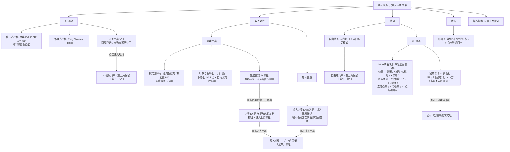

# 迁移前设计记录

历史存档，不是现行需求。来源：`docs/menu-design.md` 的 2026-11-07 工作区；内部旧相对链接按原 docs 目录解释，当前入口见 [导航](../../README.md)。

# KVB-Snooker · 游戏菜单系统设计说明（Menu Design Specification）

> 日期：2026-11-05
> 范围：`src/ui/game-menu.ts`、`src/ui/game-menu-dom.ts`、`src/app.ts`、`src/app.css`、`index.html`
> 铁律约束：严格遵守 `docs/architecture.md` 分层契约；不修改任何物理引擎、规则系统、摄像机逻辑、击球链路及单局内 HUD（比分牌、倒计时、力度条、快捷键条等）。

---

## 1. 设计目标与美学原则

1. **电子游戏级沉浸感与克制美学**：
   - 摒弃传统网页表单（原生黑色 `<select>` 平铺）与 SaaS 后台感，采用**斯诺克俱乐部暗金/台呢绿游戏界面质感**（深胡桃黑半透明毛玻璃 `#141613e6`、香槟金高光 `#e5d69d`、台呢翠绿主行动色 `#1e7a4c`）。
   - 遵循 Linear / Apple Notes 极简原则：删除多余标语和解释性副标题，依靠清晰的层级、尺寸对比、留白与交互反馈自解释。
2. **与 3D 球台及对局渲染完全解耦**：
   - 主菜单与局内菜单作为独立 UI 层叠在 3D 球台之上；展开或收起菜单**不暂停、不阻塞**底层 Babylon.js 渲染循环、AI 思考/出杆或对手击球渲染。
   - 延续 `src/ui/` 的「**零 DOM 纯状态类 (`GameMenu`) + DOM 视图类 (`GameMenuDom`)**」架构，支持在 Node 环境下对全部菜单交互逻辑进行确定性单元测试。

---

## 2. 菜单整体层级与状态流转

---

## 3. 各模块详细交互契约

### 3.1 一级主菜单（居中展示）
- 进入网页后，主菜单以居中形式悬浮于 3D 球台背景之上。
- 顶层包含五个固定入口：**`AI 对战`**、**`双人对战`**、**`练习`**、**`我的`**、**`操作指南`**。
- 点击 **`操作指南`**：返回空（无面板切换、无副作用）。
- 点击其余四个入口：切换至对应二级面板。

### 3.2 AI 对战
- 展示两个选择框与一个主按钮：
  1. **模式选择框**（图文背景卡片样式，预留图片占位框）：`经典斯诺克`、`斯诺克 900`。
  2. **难度选择框**（分段档位框样式）：`Easy`、`Normal`、`Hard`。
  3. **主按钮**：文字为 **`开始比赛`**。
- **校验逻辑**：进入该面板时模式与难度默认未选齐；任一项未选择时，`开始比赛` 按钮为灰色禁用态（`disabled`），点击无反应。两项均选中后按钮点亮，点击后收起主菜单并调用 `game.setMode("single-play", difficulty, { ruleset })` 进入人机对局。

### 3.3 双人对战
- 点击后展示两个二级切换项：**`创建比赛`**、**`加入比赛`**。

#### A. 创建比赛
- 展示两个配置区域与一个主按钮：
  1. **模式选择框**（带背景图占位框）：`经典斯诺克`、`斯诺克 900`。
  2. **局数与胜场联动框**：
     - 中文排版：`[局数下拉框] 局 [胜场普通框] 胜`（预留英文版方案 A 结构：`Best of [N] · First to [M]`，便于后续按国家/语言扩展）。
     - **局数下拉框**：可选总局数 `1, 3, 5, 7, 9, 11, 17, 19, 25, 33, 35`（初始为未选占位态）。
     - **胜场普通框**：只读展示框，当用户选择总局数 $N$ 后，自动计算并填充胜者所需胜场数 $M = \frac{N + 1}{2}$（如选 `5` 自动显示 `3`，选 `25` 自动显示 `13`，选 `35` 自动显示 `18`）。
  3. **主按钮**：文字为 **`生成比赛 ID`**。
     - 模式或总局数任一项未选择时，按钮置灰不可点击；两项均选好后点亮（若重新修改模式或局数，则重置已弹出的比赛 ID 状态）。
- **生成比赛 ID 后的弹出区（屏幕中间下方）**：
  - 用户点击 `生成比赛 ID` 后，在**屏幕中间下方**弹出一个组合区：
    - **比赛 ID 框**：展示比赛 ID 文本区域，且**在框内末尾内嵌 `复制` 按钮**（比赛 ID 后续由服务端生成，前端当前不依赖后端填入即可进入比赛）。
    - **`进入比赛` 按钮**：文字为 **`进入比赛`**，**始终可点击**。
  - 点击 `进入比赛` 后，收起主菜单与底部弹出框，启动本地双人对局（`game.setMode("single-play", "NORMAL", { ruleset, players: ["USER", "USER"] })`）。总局数 $N$ 仅作为菜单创建比赛时的 UI 状态保存，不改动现有单局规则。

#### B. 加入比赛
- 点击后弹出/展示：
  1. **输入比赛 ID 的输入框**（文本输入框）。
  2. **`进入比赛` 按钮**。
- **校验逻辑**：当前服务端尚未实现比赛 ID 校验与在线玩家展示，前端不对比赛 ID 格式做校验；当输入框为空（或仅空白字符）时 `进入比赛` 按钮置灰禁用，只要用户输入了任意内容，`进入比赛` 按钮即点亮可点击。
- 点击 `进入比赛` 后，收起主菜单，进入本地双人对战测试模式（`game.setMode("single-play", "NORMAL", { ruleset: "classic", players: ["USER", "USER"] })`）。

### 3.4 练习
- 点击后展示两个入口（无需背景图）：**`自由练习`**、**`球形练习`**。
- 点击 **`自由练习`**：收起主菜单，直接进入现有自由练习模式（`game.setMode("practice")`）。
- 点击 **`球形练习`**：展示 11 个选项：
  - **10 个带背景图占位框的预设球形卡片**：`蛇彩`、`T球形`、`X球形`、`S球形`、`Y球形`、`双马尾球形`、`双杠球形`、`订书钉球形`、`五分点练习`、`清彩练习`。点击这 10 个选项均返回空（无状态变化）。
  - **`我的球形`**：点击后进行列表展示，展示一个列表容器框：
    - 框的最上面一行是 **`创建球形`** 选项；
    - 下方内容区在未点击创建时显示 **`当前还未创建球形`**；
    - 点击 **`创建球形`** 后，显示 **`当前功能未实现`**。

### 3.5 我的
- 点击后展示三个选项：**`账号`**、**`技术统计`**、**`我的好友`**。
- 点击任意一项均返回空（无状态变化）。

### 3.6 对局内左上角「菜单」按钮与局内菜单弹窗
- 进入任何对局（AI 对战、双人对战、自由练习）后，主菜单自动收起，在**左上角保留一个简洁的 `菜单` 按钮**。
- 点击左上角 `菜单` 按钮，弹出居中的**局内菜单面板**：
  - **右上角提供关闭按钮 `×`**：点击后关闭局内菜单，继续当前对局。
  - **渲染解耦**：局内菜单仅作为 UI 叠层展示，不暂停或干扰 AI 击球、物理步进或对手击球渲染。
  - **不同模式下的局内菜单选项**：
    | 当前对局模式 | 局内菜单展示的选项 |
    | :--- | :--- |
    | **双人对战模式** | `退出对局`、`操作指南`、`重新开始` |
    | **AI 对战模式** | `暂停`、`重新开始`、`退出对局`、`操作指南` |
    | **练习模式** | `暂停`、`重新开始`、`退出练习`、`操作指南` |
  - **各按钮行为**：
    - **`暂停`**：触发预留的服务端暂停信号钩子 `onPauseSignal?: () => void`，前端 UI 层面点击后无额外变化，供后续其它模块/AI 扩展服务端暂停逻辑。
    - **`重新开始`**：使用当前对局的模式、规则集、难度与玩家配置重新加载对局（`game.setMode(...)`），并关闭局内菜单。
    - **`退出对局` / `退出练习`**：退出当前对局界面，重新展开主菜单并**回到进入该对局前的上一级目录**（AI 对战回到 `AI 对战` 面板；双人对战回到 `双人对战` 对应的创建/加入面板；自由练习回到 `练习` 面板）。
    - **`操作指南`**：返回空，点击无反应。

---

## 4. 框与按钮的差异化视觉规范

为体现电子游戏的精致层次感，菜单内的控件按职责分为 6 类样式：

1. **一级导航胶囊条（Primary Nav Bar）**：
   - 深色磨砂玻璃底板 + 微光细描边；选中项带有香槟金顶部/底部指示线与暖灰高亮底色。
2. **带背景图占位的图文卡片（Image Placeholder Card）**：
   - 用于 **模式选择（`经典斯诺克` / `斯诺克 900`）** 与 **10 种预设球形**。
   - 卡片上半部分或全幅为专门预留的 `.menu-card-media` 图片容器框（含 `data-image-slot` 属性与柔和暗色台面质感占位底色，后续可直接填入 `background-image` 或 ``），底部配渐变暗角与标题文字。
   - 必选型卡片选中时呈现香槟金边框（`#e5d69d`）与右上角选中角标；未实现型球形卡片支持悬停微抬升与按压反馈。
3. **分段选择框（Segmented Option Box）**：
   - 用于 **难度（`Easy` / `Normal` / `Hard`）**、**`创建比赛` / `加入比赛`**、**`自由练习` / `球形练习`**、**`我的` 子项**。
   - 紧凑硬朗的游戏档位块，选中时切换为高对比度实心底色与亮金边框。
4. **联动数值框与内嵌按钮输入/展示框（Compound Box）**：
   - **`_ 局 _ 胜` 组合**：左侧为可交互的深色下拉框（选总局数 $N$），右侧为只读的嵌入式数字显示框（自动显示胜场数 $M$），中间配文字“局 / 胜”。
   - **底部中央比赛 ID 框**：屏幕中下方（`bottom: 88px; left: 50%; transform: translateX(-50%)`）独立浮现的胶囊长框，左侧显示比赛 ID 区域，**框内右侧末尾内嵌 `复制` 按钮**。
   - **加入比赛 ID 输入框**：深色内凹游戏输入框，聚焦时边框亮起香槟金。
5. **主行动按钮（Primary CTA Button）**：
   - 用于 **`开始比赛`**、**`生成比赛 ID`**、**`进入比赛`**。
   - 未满足前置条件时：低饱和度深灰底色（`#232622`）+ 暗灰文字（`#666b62`）+ `disabled` 属性，明确传达不可点击。
   - 满足条件激活时：斯诺克台呢翠绿渐变（`linear-gradient(180deg, #258a55, #18633b)`）配亮白加粗字与微光内边框，悬停提亮，点击有 `translateY(1px)` 下压反馈。
6. **列表容器框（List Container Box）**：
   - 用于 **`我的球形`**：外层为带边框的深色列表面板，第一行是带底部分隔线的可点击操作行 `创建球形`，下方为空状态展示区（默认显示 `当前还未创建球形`，点击 `创建球形` 后显示 `当前功能未实现`）。

---

## 5. 模块拆分与文件规划（单文件 ≤ 400 行）

| 文件路径 | 职责 |
| :--- | :--- |
| `src/ui/game-menu.ts` | 零 DOM 状态机 `GameMenu`：管理主菜单层级、AI/双人/练习/我的状态、`_ 局 _ 胜` 自动换算、按钮可用性校验、局内菜单选项生成及上一级目录回退逻辑 |
| `src/ui/game-menu-dom.ts` | DOM 视图层 `GameMenuDom`：渲染居中主菜单、底部比赛 ID 浮层、左上角 `菜单` 按钮与局内菜单弹窗，绑定事件并同步 `GameMenu` 状态 |
| `src/ui/__tests__/game-menu.test.ts` | Vitest 单元测试：覆盖全部五个一级选项、AI 必选校验、双人创建（1~35 局胜场自动计算、ID 弹窗、进入比赛）与加入比赛、练习/球形/我的球形列表框、局内菜单按模式区分选项及退出回退 |
| `src/app.ts` / `index.html` / `src/app.css` | 浏览器装配根接线与游戏化菜单样式实现 |
